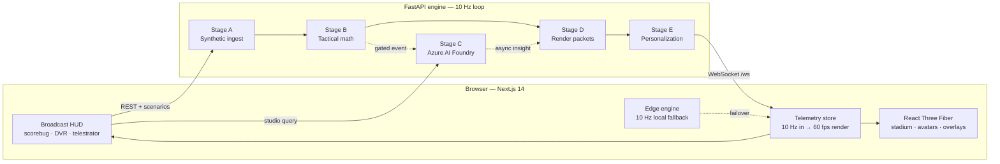

<div align="center">

# AETHER PITCH

### The Zero-Hallucination 3D Football Broadcast Studio & Multi-Agent Tactical Twin

**A real-time 3D football broadcast studio driven by 100% synthetic telemetry and a deterministic five-stage AI pipeline with optional Azure AI Foundry reasoning.**

[](https://nextjs.org/)
[](https://docs.pmnd.rs/react-three-fiber)
[](https://fastapi.tiangolo.com/)
[](https://www.python.org/)
[](https://azure.microsoft.com/)
[](#synthetic-data)

**Repository:** `github.com/shashankh3/aether-pitch` · **Branch:** `main`
**Scale:** 108 tracked files · ~14,000 LOC (Python 3.11 + TypeScript 5 / React 18) · **220 automated assertions** (154 backend · 36 headless logic · 30 headless UI render) · 16-resource Azure ARM template

> **The hook:** *AETHER PITCH is a live 3D football broadcast where every number on screen is computed by transparent football mathematics, every AI claim is graded by a deterministic numeric critic, and the cloud can die mid-match without the picture ever dropping a frame.*

[Quick Start](#quick-start) · [Judge Quick Start](#judge-quick-start-60-seconds) · [Features](#features) · [Architecture](#architecture) · [API](#api-reference) · [Configuration](#configuration) · [Testing](#testing--verification)

</div>

---

## 1. Executive Summary

Live sports broadcasts force a false choice: raw telemetry dashboards that overwhelm casual fans, or generative AI commentary that hallucinates statistics. **AETHER PITCH** eliminates both.

Running entirely on self-generated, IP-clean synthetic telemetry — **North Larchmont Athletic (NLA)** vs. **Meridian City SC (MCS)** in the *AETHER Synthetic League* at the *AETHER 3D DIGITAL TWIN* — the platform operates a deterministic five-stage pipeline at **10 Hz**, interpolated to **60 FPS** in WebGL:

1. **Stage A (Ingest):** Frame-for-frame reproducible 22-player kinematics, ball physics, machine auto-eventing and a metabolic bio-load digital twin (`seed=42`).
2. **Stage B (Math):** Pure NumPy spatial analytics — Expected Threat, Pass Difficulty, Pitch Control, Chaos Index, PPDA and counterfactual Ghost Passes.
3. **Stage C (Explain):** Azure AI Foundry (`gpt-4o` + `gpt-4o-mini`) multi-agent orchestration governed by a deterministic **Numeric Critic** that rejects any narrative claim not traceable to live Stage B state.
4. **Stage D (Render):** Synchronized React Three Fiber volumetric telestration, automated camera work, and SMPTE alpha broadcast overlays.
5. **Stage E (Personalize):** Per-fan cognitive density, persona adaptation, colourblind-safe palettes and 4-language localization (EN / ES / AR / HI) via Azure AI Translator.

**The problem:** a live match produces thousands of events, but analysts, casual fans and broadcasters each need a different explanation, in the language and context they care about, without waiting on a studio. **The solution:** AETHER PITCH ingests synthetic 10 Hz telemetry, interprets it with deterministic football math, explains key moments with Azure AI Foundry-hosted agents, renders synchronized 3D/AR overlays, and personalizes the same moment by persona, density, metric, club, player and language.

The project was built for the **Microsoft Premier League Hackathon ("Inside the Game")**. Azure services are optional: without credentials every stage falls back to a deterministic local implementation, so the full studio runs offline.

| Document | What it covers |
|---|---|
| [SUBMISSION_GUIDE.md](SUBMISSION_GUIDE.md) | Full architecture, mathematical appendix, sub-two-minute demo script, Official Rules checklist, paste-ready portal answers |
| [docs/ARCHITECTURE.md](docs/ARCHITECTURE.md) | Module map, data flow, the five stages, the four resilience layers, the counterfactual sandbox |
| [docs/RUNTIME_CONFIG.md](docs/RUNTIME_CONFIG.md) | Why the studio hydrates its backend coordinates server-side per request instead of using `NEXT_PUBLIC_*` |
| [CONTRIBUTING.md](CONTRIBUTING.md) | The verification gate, the branch policy and the non-negotiable ground rules |

## Judge Quick Start (60 seconds)

Open the app and a dismissible card routes you straight to the evidence for each prize track — no hunting through menus.

| Prize track | One click opens | What you see |
|---|---|---|
| **Best Use of Microsoft Foundry** | Control Center → **Data** | Foundry Eval & Responsible AI scorecard (groundedness, tactical coherence, Prompt Shield status, P95 frame SLA), the **Microsoft Foundry Route** card showing the real triage/narrative deployments, API version, request id, token usage and the active RAI layer, plus the 4-node grounded handoff DAG. |
| **Best Multi-Agent System** | Control Center → **Studio** | The **Bench War-Room**: a genuine **sequential three-call debate** — `NLATacticalManagerAgent` proposes, `MCSOppositionScoutAgent` counters (reading turn 1), `SpatialArbiterAgent` adjudicates (reading turns 1–2). Each card shows its own model deployment, latency, token count and Stage B tool bundle. The verdict lands as a 3D tactical prescription. |
| **Best Azure Cloud Native** | Control Center → **Ask AI** | The distributed pipeline trace and the **Cloud Resilience & Edge Failover Drill** — one click simulates a 6-second cloud outage and measures the hot-swap latency, 10 Hz continuity and state reconciliation. |

**And if you only have 30 seconds:** open the bottom dock → **Replay** → **What-If Sandbox**, grab a player and drag him. The pitch-control surface and Expected Threat recalculate live under your cursor — the 3D stage is a tactical sandbox, not a video.

Prefer to be driven? **Controls → Autopilot** runs the full 80-second guided tour with voiceover, ending on the recap and the rubric proof.

## Highlights

- **Cinematic 3D broadcast** — a procedural night stadium, 22 articulated player rigs, four camera modes, choreographed camera intros, dynamic FOV, score-impact camera shake, volumetric overlays, and broadcast alpha output.
- **Five-stage pipeline** — synthetic ingest, deterministic tactical math, asynchronous AI explanation, render packets, and personalization.
- **Grounded agent handoff trace** — deterministic gate → triage → causal analyst/critic → broadcast director, with measured latency, gate economy, P95 audit metrics, and numeric cross-checks of Azure narrative claims.
- **Adversarial multi-agent debate** — a 3-agent bench war-room adjudicated against a live Expected Threat tensor, with a projected 30-second ΔxT gain and win-probability swing.
- **Enterprise Responsible AI** — a Foundry Prompt Shield that blocks prompt injection, off-topic and third-party queries before the model is called, a club-neutrality check, and a live eval scorecard with a one-click grounding audit.
- **Predictive bio-load digital twin** — rolling metabolic load, a +10-minute stamina projection and a fatigue-adjusted PDR penalty for every player, with a tactical relief directive.
- **Explainable analytics** — Pass Difficulty Rating, Expected Threat, Ghost Pass, Chaos Index, pressing metrics, live pitch-control territory splits and defensive line analysis.
- **Fan runtime** — persona modes, cognitive telemetry density, metric locking, club bias, locked players, a colorblind-safe palette, and EN/ES/AR/HI commentary without restarting the stream.
- **Studio-grade interactions** — focus-managed dialogs, Escape/outside-click dismissal, ARIA live regions, reduced-motion support, a recoverable error boundary, and a responsive Control Center bottom sheet.
- **Resilient by design** — a 10 Hz browser edge engine takes over if the WebSocket or backend pipeline drops, then hot-swaps back when it returns — provable with a one-click failover drill.
- **Infrastructure as code** — a declarative ARM template for Azure AI Foundry, Azure AI Translator, Key Vault + managed identity, Container Apps, Application Insights and Azure Monitor alerts.

## Contents

- [Features](#features)
- [Architecture](#architecture)
- [Quick Start](#quick-start)
- [Configuration](#configuration)
- [Using the Studio](#using-the-studio)
- [API Reference](#api-reference)
- [Project Structure](#project-structure)
- [Testing & Verification](#testing--verification)
- [Deployment](#deployment)
- [Synthetic Data](#synthetic-data)
- [Contributing](#contributing)
- [License](#license)

## Features

### Broadcast and visualization

- **Cinematic night stadium** — procedural mowed turf, regulation markings, goalposts and nets, LED advertising boards, a tiered bowl with roof lighting, 1,600 instanced crowd figures, camera flashes, floodlight beams, twin jumbotrons, stars, moon, and a procedural ball trail.
- **Camera choreography** — a cinematic intro move, broadcast-grade dynamic field of view, ball-following push, score-impact shake, and clamped Pro Cam / auto-director framing.
- **22 articulated avatars** with procedural gait, sprint lean, kick animation, goalkeeper stance, jersey numbers, and signature-trait badges.
- **Four camera modes** — Tele Cam, Pro Cam, Drone Orbit, and Auto-Director. AI camera directives can take over temporarily; a manual camera choice cancels the takeover.
- **15-second DVR and 3D telestrator** — freeze and scrub live play, inspect sprint/chaos markers, and draw spotlight pillars, an offside wall, a compactness hull, ghost-ball replays, and tactical arrows.
- **Tactical layers** — xT threat grid, defensive laser links, parabolic pass tubes, Ghost Pass counterfactuals, pitch-control surface, and passing network.
- **Broadcast alpha mode** — open `/?overlay=alpha` for a transparent/chroma-ready AR layer with SMPTE timecode and a machine-readable render-partner packet.
- **Match chrome** — scorebug, momentum and win-probability bars, tactical pulse, lower thirds, GOAL slam with confetti, and player lock hologram.
- **Measured render telemetry** — a live frame-rate and frame-time chip sampled from the real `requestAnimationFrame` loop, so the performance number on screen is the number the machine is delivering.
- **Clean-feed presentation** — `H` hides the HUD for a framed cinematic feed, `F` toggles fullscreen, and the Controls drawer exposes camera modes and core AR toggles on mobile.

### AI and analytics

- **Stage A — ingest:** deterministic 10 Hz PitchForge simulation with match metadata, 3D pose state, ball physics, pass completion, tackles, auto-evented sprint/distance thresholds, milestone tracking, and a metabolic bio-load digital twin.
- **Stage B — interpret:** NumPy tactical math for Chaos Index, PDR, 16 × 12 xT, Ghost Pass, AI gating, leverage, PPDA, defensive lines, pitch-control territory splits, top-xT zones, passing-network edges, and team/player match stats (passes, accuracy, shots, tackles, possession, distance).
- **Stage C — explain:** asynchronous causal narratives and studio answers through Azure AI Foundry-hosted Azure OpenAI deployments (triage → narrative), with a deterministic local fallback.
- **Agent trace:** every gated insight ships a `trace_id`, four-node handoff chain, gate decision, Stage C route, numeric grounding result, and compute economy; the Data tab renders it as a compact DAG and the audit API reports P95 latency plus live gate economy.
- **Stage D — render:** time-coded overlay packets, highlight zones, and camera directives for the 3D scene.
- **Stage E — personalize:** analyst/casual/split personas, metric lock, club lens, locked-player context, and localized commentary.
- **Ask The 12th Man:** ask a tactical question and receive a reasoning chain, localized answer, commentator cue, and a scene directive that moves the camera and overlays.
- **Three-act recap:** milestone-driven storyboard with full 22-player snapshots, ghost passes, localized narration, teleprompter export, and 3D time travel.

### Fan experience and reliability

- **Fan Personalization Tuner** with live persona, metric, club, player, and language controls, pressed-state semantics, Escape dismissal, and outside-click close.
- **80-second judge autopilot** that runs a six-step guided tour with synchronized voiceover, a sequenced recap-to-rubric finale, and no modal overlap.
- **Fan-first Control Center** that keeps the pitch uncluttered by default and reveals the five-stage pipeline ribbon, match-intelligence panel, payload inspector, and one-click rubric audit from one optional drawer; audit data is also available at `GET /api/health/pipeline-audit`.
- **Accessible production dialogs** for the overlay packet, rubric audit, three-act recap, and studio recap with focus trap, focus restoration, scroll lock, labelled titles, and live status regions.
- **Responsive studio layout** — compact mobile dock, icon-first scenario controls, scroll-safe overlays, and reduced-motion support.
- **Resilient match engine** that switches to a browser-native 10 Hz simulation during backend or Azure failures.

## Phase 2 — Agentic Studio Co-pilot & Counterfactuals (v6.1)

### Interactive "Ask The 12th Man" co-pilot
- **Agentic tool-calling UI**: quick-prompt chips (ghost pass, defensive gap, chaos spike, recap), typed/voice queries, Azure AI Foundry routing with deterministic fallback.
- **Specialist routing**: every question is classified (Spatial Analyst, Ghost-Pass Counterfactual, Match Analyst, Story Director) with a 3-step reasoning chain, localized answer (EN/ES/AR/HI), commentator cue, and grounded citations (2–3 numeric facts from Stage B).
- **Action buttons**: Focus Gap → camera directive, Lock Player → spotlight, Show Ghost Pass → animate counterfactual arc, Generate Recap → open 3-act storyboard.
- **Offline resilience**: if Azure or WebSocket fails, the EdgeEngine produces the same specialist/citation/action schema locally.

### Ghost-Pass counterfactual simulator (Stage B + 3D)
- **Backend**: `ghost_pass()` now returns `actual_delta_xt`, `ghost_delta_xt`, `net_xt_gain`, `completion_probability` (18–97%), `receiver_target_xy`, `distance_m`, `openness_m`.
- **Telemetry**: `GhostSample` and ball state carry all counterfactual fields; DVR circular buffer records them for 15 s.
- **DVR UI**: comparison strip shows Actual ΔxT → Ghost ΔxT → Net ΔxT + completion % when a ghost lane is live; “Play counterfactual” button triggers the 3D arc.
- **3D visualization**: `PassVectors3D` badge shows Ghost ΔxT, Net ΔxT, completion %; `Telestrator3DOverlays` animates a pulsing cyan target ring at the ghost receiver when the ghost replay is active.

### Mute-proof broadcast captions
- **LiveCaptionStrip** (fixed bottom bar): 4 animated waveform bars, active locale tag (EN/ES/AR/HI), “CC · LIVE / MUTED / READY” status.
- **Zero-overlap speech controller**: cancel-before-queue, `stopSpeaking()` on autopilot step changes, language switches, and mute toggle; captions persist when muted.
- **Alpha-mode clean**: caption bar auto-hides when `?overlay=alpha` or Cinema Mode (`H`) is active.

### Exportable audit dossier
- **MatchRecapStudioModal** adds “Dossier JSON” and “Dossier MD” buttons.
- **JSON dossier** includes: match summary (fixture, score, provenance), deterministic Stage B dossier (peak chaos, PPDA, top 3 ΔxT, ghost counterfactual), 3-act storyboard, Foundry multi-agent trace (handoff chain, grounding, guardrail, P95 latency), compliance attestation.
- **Markdown dossier**: human-readable version of the same sections for reviewers.

### Expanded automated tests
- `backend/test_pipeline.py` now asserts:
  - Studio query schema for all 4 specialist types with `answer`, `agent_specialist`, 2-3 `grounding_citations`, 2-3 `suggested_actions` (valid types).
  - Ghost counterfactual payload completeness and `net_xt_gain` formula.
  - Pipeline audit includes `stage_b_summary`, `match_summary`, and `synthetic_data_compliance`.
  - All four God Mode scenarios (`chaos_counter`, `high_press_turnover`, `tactical_inversion`, `halftime_recap`) execute without error.

## Phase 3 - Adversarial Bench War-Room, Foundry RAI, 3D Spatial Layers & Proof-Jumper (v6.2)

### Adversarial Bench War-Room (Best Multi-Agent System)
- **`POST /api/tactical-war-room`** runs a genuine **sequential three-call debate** grounded in live Stage B telemetry — not one model role-playing three voices:

| Turn | Agent | Model tier | Stage B tool bundle | Reads |
|---|---|---|---|---|
| 1 | `NLATacticalManagerAgent` | narrative (`gpt-4o`) | defensive line height, top xT zones, xT at gap, ghost pass, pitch control, passing network | live telemetry |
| 2 | `MCSOppositionScoutAgent` | triage (`gpt-4o-mini`) | rolling PPDA, press intensity, pace, Chaos Index, team stats | turn 1 |
| 3 | `SpatialArbiterAgent` | narrative (`gpt-4o`) | top xT zones, xT at gap, pitch control, Chaos, bio-load stamina, defensive line | turns 1 & 2 |

  Each agent is a **separate model invocation** with its own tool bundle, and the tools are the deterministic Stage B engine — so an agent reasons about the space without ever inventing a number. The arbiter issues the **Tactical Prescription** (e.g. invert RB into the 78,12 half-space for a 4v3 overload).
- **Output contract:** `agent_debate_transcript` (`manager_proposal`, `scout_counter`, `arbiter_verdict`), `recommended_adjustment` (title + directive), `projected_30s_xt_delta`, `win_prob_shift_pct`, `target_zones`, `adjustment_vectors`, plus `agent_calls` (agent, deployment, tool bundle, latency, token usage) and `orchestration` — the multi-agent claim is inspectable, not asserted.
- **Studio (`prod`) tab UI:** each debate card shows its own model deployment, latency, token count and tool count; `+ΔxT` / `+WIN PROB` badges; and **"Project Tactical Shift on 3D Pitch"** which highlights the overload zones as pulsing ground rings and draws the adjustment vectors as glowing arrows on the 3D Digital Twin.
- **Zero-config fallback:** `edgeWarRoom()` in `frontend/src/lib/edgeEngine.ts` reproduces the identical three-agent, three-turn debate offline.

### Microsoft Foundry Responsible AI (Best Use of Microsoft Foundry)
- **Pre-flight Prompt Shield (`backend/rai_shield.py`)** screens every user query **before a token reaches Azure OpenAI**: it detects prompt injection (instruction override, role hijack, jailbreak, prompt exfiltration, guardrail bypass), off-topic queries, and third-party real-world entities. A blocked query never calls the model — the caller gets a grounded, localized deflection back to the live NLA vs MCS telemetry in EN/ES/AR/HI. Verified by an assertion that counts **0 model calls** on a blocked query.
- **Post-flight numeric critic (`backend/agent_trace.py`)** extracts every numeric claim from a model narrative and cross-checks it against live Stage B tensors within strict tolerance. An ungrounded or club-biased narrative is **rejected and replaced** with the deterministic, objectively grounded alternative; the discarded narrative is retained in the trace for audit.
- **Azure AI Content Safety (`backend/content_safety.py`)** runs as an optional **second, independent RAI layer** on top of the deterministic shield when configured. It can only add evidence, never remove protection.
- Every response carries `foundry_safety_shield` with `prompt_shield_status` (`CLEAR` / `PROTECTED`), `numeric_grounding_pass`, `club_neutrality_pass` and the content-safety verdict.
- **Foundry Eval & Responsible AI Scorecard** in the Control Center **Data (`data`)** tab renders four live telemetry metrics: Mathematical Groundedness, Tactical Coherence, Prompt Shield status (hallucinations / policy breaches), and P95 Broadcast Frame SLA against the 100 ms budget.
- **"Run Live Foundry Grounding Audit"** button fetches `/api/health/pipeline-audit` and flashes a verified, timestamped audit receipt.

### 3D Passing Network & Spatial Pitch Ownership
- **Stage B math:** `pitch_control_split` (`nla_territory_pct` / `mcs_territory_pct` / `neutral_pct`) attributes every 16x12 xT cell by proximity + velocity-weighted influence; `passing_network_edges` returns the top 5 high-value lanes as `[from_id, to_id, xt_weight]` with coordinates; `top_xt_zones()` returns the highest-Expected-Threat cells for both attacking directions — the agents' ground truth.
- **Stats tab:** live **Spatial Pitch Control Bar** (NLA % vs MCS %).
- **CV tab:** **Homography Calibration Status** (`105x68m Regulation Standard Locked`), **14-Joint Skeletal Pose Distribution** counted live across all 22 players, and a **"3D xT Passing Network"** toggle.
- **3D Digital Twin:** glowing passing-lane tubes scaled by `xt_weight` (the same tensor the math uses, so the picture and the numbers can never disagree).

### Judge Rubric Proof-Jumper
- The autopilot tour bar now carries three **"Inspect Live Proof"** buttons, one per prize track, that open the exact Control Center tab holding that track's evidence:

| Prize track | Opens | Shows |
|---|---|---|
| Best Use of Microsoft Foundry | Data (`data`) | Foundry Eval & RAI Scorecard + 4-node handoff DAG |
| Best Multi-Agent System | Studio (`prod`) | 3-Agent Bench War-Room + handoff DAG |
| Best Azure Cloud Native | Ask AI (`copilot`) | Distributed trace + dual-engine failover inspector |

## Phase 4 - Cloud Failover Drill, Predictive Bio-Load Twin, Inclusive Tuner & Compliance Gate (v6.2)

### Interactive "Cloud Outage & Zero-Downtime Edge Failover Drill"
- **`triggerFailoverDrill(durationMs = 6000)`** in `useResilientMatchEngine.ts` simulates a real cloud disconnect: the WebSocket closes, the browser-native 10 Hz `EdgeEngine` takes over the picture with **zero dropped 3D frames**, and the stream reconnects and reconciles the match clock and state.
- **`failoverDrillState`** reports `active`, `swapLatencyMs`, `framesDropped` (always 0), `reconciledTicks`, and a `phase` (`idle` → `outage` → `reconciling` → `verified`).
- **Data tab card** "Cloud Resilience & Edge Failover Drill" shows live badges: `Hot-Swap Latency`, `10Hz Telemetry Continuity: 100% (0 Dropped Frames)`, and `State Reconciliation: VERIFIED`.
- **PipelineRibbon** carries an amber `EDGE DRILL` badge during the outage and flips to an emerald `DRILL OK` once reconciliation is verified.

### Collective Defensive Line Scrubber
- **Slide a whole defensive line**, not just one player: a broadcast-style slider shifts the backline unit of either team between **18 m and 52 m from their own goal line**, in the Sandbox HUD *and* in the DVR dock.
- **The whole block moves:** the four deepest own-goal players slide as a unit and the midfield compresses by 0.45 × the shift, preserving a realistic block topology.
- **Live consequence read-out** computed by the Stage B twin: `through_ball_exposure_xt` (Expected Threat in the band the defence vacates, weighted by opposition forward velocity), `offside_trap_catch_prob_pct` (logistic on attacker proximity to the shifted line and line cohesion), `press_compression_gain_pct` (reduction in opposition-usable central cells) and the block's `compactness_area_m2` before and after.
- **The 3D responds:** the offside wall and the compactness convex hull are rebuilt from the *shifted* players, so the block physically slides on the pitch as you drag.
- **Byte-identical twins.** The browser and the server implement the same function over the same 16×12 xT grid — verified field-for-field across all eight scenarios. The browser's xT surface was also aligned to the backend's grid, so the delta a judge sees locally is the number the arbiter adjudicates.

### Counterfactual Dossier & Rubric Integration
- **Every experiment is logged.** A session ledger records each player drag and each line shift with its clock, displacement, ΔxT, Δ pitch control, exposure, vulnerability index, scenario id, trace id and grounding verdict.
- **Serialized into the dossier.** The Recap Studio's **JSON** and **Markdown** exports now carry a `counterfactual_lab` section — experiment count, how many were numerically grounded, and every individual experiment with its evidence.
- **A new rubric row.** The rubric verifier shows the sandbox as an exercised verification line: how many experiments were run, how many passed the numeric critic, and how many drags versus line shifts.

### Interactive Spatial "What-If" Counterfactual Sandbox
- **The 3D stage is not an observer feed — it is a tactical sandbox.** Open the **Replay** popover on the bottom dock, arm the **What-If Sandbox**, then grab any avatar and drag it across the grass.
- **Live Stage B recomputation:** the browser-native twin re-evaluates the *same* `xtValue` surface and the *same* 16×12 territory attribution used by the live pipeline, so the deltas are the pipeline's own numbers — not an approximation. Moving the NLA right-back 15 m inside shifts NLA territory −0.5 pts and hands MCS +3.2 pts, and the xT at that position drops 0.028 → 0.022.
- **Broadcast-grade feedback:** a ghost anchor ring stays at the original telemetry position, a glowing tether measures the displacement, a pulsing target ring marks the drop point, and a glass HUD reports Δ Expected Threat, Δ Pitch Control and the opponent's territory in real time.
- **60 FPS by construction:** the drag state lives in a mutable store (like the telemetry store) and the HUD subscribes to it directly, so neither the page nor the React tree re-renders during a drag — the avatar interpolates its position inside its own `useFrame`.
- **Hand it to the agents:** **"Send to War-Room"** posts the relocation to `POST /api/tactical-war-room`, where the `SpatialArbiterAgent` receives it as a Stage B tool and adjudicates the structural consequence. **"Submit to Arbiter"** posts it to `POST /api/counterfactual-query` for a focused, numeric-critic-verified verdict with a `structural_vulnerability_index` and a recommended compensation move.

#### `POST /api/counterfactual-query` — the arbiter contract

Pydantic-validated request and response, defined in `backend/main.py`:

```text
CounterfactualRequest
  match_id: str
  minute: float
  displacements: List[CounterfactualDisplacement]
      player_id: int                 # shirt number
      canonical_player_id: str?      # engine id, e.g. "NLA_2"
      team: str · role: str
      original_coords: (x, y)        # absolute pitch metres
      displaced_coords: (x, y)
      delta_distance_m: float
  baseline_xt: float
  baseline_pitch_control: {"nla_territory_pct": float, "mcs_territory_pct": float}
  current_chaos_index: float

CounterfactualEvaluation
  scenario_id: str
  projected_xt_shift: float
  pitch_control_shift_pct: {"nla_territory_pct": float, "mcs_territory_pct": float}
  structural_vulnerability_index: float      # [0.0, 1.0]
  arbiter_verdict: str                       # max 3 sentences
  recommended_compensation_move: {"player_id": int, "target_xy": [x, y]}
  numeric_grounding_verified: bool
  trace_id: str
```

**The server never trusts the client's arithmetic.** Every shift is recomputed from the live Stage B engine; the client baseline is only used as a cross-check, and an unresolvable player is rejected with a `404` rather than scored.

### Predictive Bio-Load Digital Twin
- **Stage A** accumulates a rolling high-intensity metabolic load per player and publishes a `bio_load_profile` on every tick: `sprint_load_index` (0–100), `projected_stamina_10m`, `fatigue_pdr_penalty`, `high_intensity_seconds`, `stamina_now`, `relief_required`, and a role-specific `tactical_relief_directive` (e.g. *"Shift #7 to a compact mid-block; delegate the wide pressing trigger to the inverted fullback"*).
- **Stage B** interprets it via `bio_load_summary`: mean load, mean +10m projection, worst PDR penalty, and the three most at-risk players.
- **PlayerLock 360** renders a "Bio-Load & +10m Stamina Forecast" meter (12-segment load bar, projection bar, PDR penalty) and the relief directive badge, and the live-voice readout now speaks the fatigue projection.

### Adaptive Cognitive-Load & Inclusive Broadcast Tuner
- **Three Cognitive Telemetry Density presets** in the Control Center **Fan (`fan`)** tab:
  - `CASUAL_STORYTELLER` — jargon-free callouts, raw grid numbers hidden.
  - `FANTASY_HUNTER` — speed milestones, stamina burn, individual ΔxT.
  - `PRO_TACTICAL_DIRECTOR` — full Stage B density (xT, PDR, PPDA, ghost-pass deltas, Voronoi traps).
- **Colorblind-Safe Broadcast Palette** toggle (deuteranopia/protanopia): the 3D defensive laser overlays and HUD status pills shift from red/green to electric cyan `#00E5FF` vs warm amber `#FFB300` / magenta `#FF00D4`.

### Automated Official Rules & Trademark Compliance Audit
- **`test_rules_and_trademark_compliance()`** in `backend/test_pipeline.py` proves §4.3 / §4.4 / §4.6 / §4.7 / §4.11 compliance with pure Python `pathlib` (no external CLI):
  - Synthetic metadata is strictly NLA vs MCS in the `AETHER Synthetic League`.
  - `seed=42` replays frame-for-frame identically.
  - `bio_load_profile` and every Stage A–E payload key are present.
  - **0** third-party sponsor / league / kit-brand / broadcaster / social strings across all shipped `frontend/src` + `backend` sources (56 files scanned).
  - **0** external media asset references.
- **`SUBMISSION_GUIDE.md` §14** ships paste-ready answers for the submission portal: project summary & tagline, Foundry + multi-agent orchestration, cloud-native architecture & edge resilience, the synthetic-data compliance attestation, and prize-track one-liners.

## Architecture

```text
BROWSER CLIENT (Next.js 14 / React 18 / React Three Fiber)
 ├─ 3D Volumetric Stage: Procedural Stadium · 22 Articulated Avatars (14-part rigs) · Broadcast Camera Rig
 ├─ Broadcast HUD: TopBar · ScoreBug · LeftRail · BottomDock (DVR) · RightDock (8-Tab Control Center)
 ├─ Telemetry Store: 10 Hz WebSocket Ingest ──► 60 FPS interpolation (linear + velocity extrapolation)
 └─ EdgeEngine (1,371 LOC browser-native twin) ◄── active hot-standby, 0 ms reload on cloud drop
        │
        │ WebSocket (/ws @ 10 Hz) + REST control plane
        ▼
FASTAPI BACKEND ENGINE (10 Hz deterministic loop)
 ├─ Stage A  Synthetic ingest (997 LOC) ──► kinematics, ball physics, auto-eventing, bio-load twin
 ├─ Stage B  Deterministic math (585 LOC) ──► xT grid, PDR, PPDA, Chaos, pitch control, ghost pass
 ├─ Stage C  Foundry agent router (1,144 LOC) ──► 4-node insight pipeline + 3-turn war-room
 ├─ RAI & numeric critic (607 LOC) ──► prompt shield + grounding verifier + club-neutrality gate
 └─ Stage D & E  Personalizer (413 LOC) ──► camera directives, overlays, persona & i18n
        │
        ├──► Azure AI Foundry (Azure OpenAI: gpt-4o narrative / gpt-4o-mini triage)
        ├──► Azure AI Translator (real-time EN / ES / AR / HI broadcast localization)
        └──► Azure AI Content Safety (optional cloud secondary RAI inspection layer)
```

### Cloud-to-edge zero-downtime failover

Live broadcasts cannot show a loading spinner. Every backend mathematical model, bio-load curve and tactical war-room heuristic has a deterministic TypeScript counterpart inside `edgeEngine.ts`. If the WebSocket drops — or when a judge triggers the **6-Second Failover Drill** in the Data tab — `useResilientMatchEngine.ts` hot-swaps to the browser-native engine mid-frame, measures the exact failover latency, and reconciles state on reconnection.

```text
Cloud drop ─► socket closed ─► EdgeEngine takes the picture (0 frames dropped)
                          ─► measured hot-swap latency
                          ─► reconnect ─► clock + state reconciled ─► badge flips to VERIFIED
```




The 10 Hz loop never waits on Stage C. Cloud reasoning is dispatched as an async task, so a slow model cannot stall the match. If Azure credentials are absent, Stage C and Stage E use deterministic local fallbacks and Stage D stays on the local WebSocket transport.

Each gated insight now carries an `agent_trace`: the Stage B gate decision, measured Stage C triage/narrative timings, numeric grounding results, and the Stage D/E broadcast handoff. If an Azure narrative cites a number that cannot be matched to the Stage B snapshot, the guardrail replaces it with the deterministic template and records the unmatched tokens. This is a logical pipeline trace over the shipped router, not a claim that the project runs a separate hosted agent framework.

### Pipeline contract

| Stage | Responsibility | Key outputs | Blocking |
|---|---|---|---|
| **A — Ingest** | Synthetic physics, player/ball state, event and milestone detection | Match metadata, 22 players, ball, pose state, distance/speed, pass/tackle events, milestones | Yes, 10 Hz heartbeat |
| **B — Interpret** | Deterministic NumPy tactical analysis | Chaos, PDR, xT, Ghost Pass, gate, leverage | Yes, sub-millisecond |
| **C — Explain** | Azure AI Foundry-hosted models (triage → narrative) and local fallback narratives | Commentary, studio answers, recap acts | No, asynchronous |
| **D — Render** | Broadcast overlay and camera packets | Overlays, highlight zones, camera directives | Yes, cheap |
| **E — Personalize** | Persona, metric, club, player, and language adaptation | Localized fan story and HUD payload | Yes, cheap |

### Technology stack

| Layer | Technologies |
|---|---|
| **Frontend** | Next.js 14 (App Router), React 18, TypeScript, React Three Fiber, Three.js, Drei, postprocessing, Tailwind CSS |
| **Backend** | Python, FastAPI, Uvicorn, NumPy, Pydantic, python-dotenv |
| **AI and cloud (optional)** | Azure AI Foundry-hosted Azure OpenAI, Azure AI Translator; Docker and an optional Azure Container Apps deployment path |
| **Delivery** | Docker, Docker Compose, Azure Developer CLI (`azd`), start scripts for Windows and macOS/Linux |

## Quick Start

### Prerequisites

| Requirement | Version |
|---|---|
| Python | 3.11+ recommended |
| Node.js | 20+ |
| npm | 10+ |
| Docker | Optional, for the container stack |

### One-command launch

**Windows**

```bat
start_studio.bat
```

**macOS / Linux**

```bash
bash start_studio.sh
```

The launcher installs dependencies, starts both services, and opens the studio.

| Service | URL |
|---|---|
| Studio UI | http://localhost:3000 |
| Backend | http://localhost:8000 |
| OpenAPI docs | http://localhost:8000/docs |

### Manual launch

Terminal 1 — backend:

```bash
cd backend
python -m venv .venv

# Windows
.venv\Scripts\activate

# macOS / Linux
source .venv/bin/activate

python -m pip install -r requirements.txt
python -m uvicorn main:app --reload --port 8000
```

Terminal 2 — frontend:

```bash
cd frontend
npm install
npm run dev
```

Open http://localhost:3000.

### Docker Compose

```bash
docker compose up --build
```

The backend health check uses `GET /api/health`; the frontend waits for the backend to become healthy before starting.

### Azure deployment

The full stack is defined as declarative infrastructure in [`infra/main.json`](infra/main.json): Azure AI Foundry (AI Services) with a triage and a narrative model deployment, Azure AI Translator, Key Vault with a user-assigned managed identity, an Azure Container Apps environment running both services, Application Insights and Azure Monitor alerts.

```bash
az deployment group create \
  --resource-group rg-aether-pitch \
  --template-file infra/main.json \
  --parameters prefix=aether openAiApiKey=<foundry-key> translatorKey=<translator-key>
```

See [`infra/README.md`](infra/README.md) for the full deploy walkthrough, the runtime-configuration contract, and the offline validator (`python infra/validate_template.py`).

## Configuration

Copy the example environment file before adding Azure credentials:

```bash
cp backend/.env.example backend/.env
```

On Windows PowerShell:

```powershell
Copy-Item backend/.env.example backend/.env
```

All Azure settings are optional. Without them, the studio runs on deterministic local fallbacks.

| Variable | Default | Purpose |
|---|---|---|
| `AZURE_OPENAI_ENDPOINT` | empty | Azure OpenAI / AI Foundry endpoint for Stage C |
| `AZURE_OPENAI_API_KEY` | empty | Stage C API key |
| `AZURE_OPENAI_API_VERSION` | `2024-06-01` | Azure OpenAI API version |
| `AZURE_OPENAI_TRIAGE_DEPLOYMENT` | `gpt-4o-mini` | Fast triage model deployment |
| `AZURE_OPENAI_NARRATIVE_DEPLOYMENT` | `gpt-4o` | Narrative and recap model deployment |
| `AZURE_TRANSLATOR_KEY` | empty | Azure AI Translator key for Stage E |
| `AZURE_TRANSLATOR_ENDPOINT` | `https://api.cognitive.microsofttranslator.com` | Translator endpoint |
| `AZURE_TRANSLATOR_REGION` | `global` | Translator region |
| `AZURE_WEBPUBSUB_CONNECTION_STRING` | empty | Reserved; the shipped hub uses the local WebSocket (Web PubSub is not wired) |
| `AZURE_WEBPUBSUB_HUB` | `aether` | Reserved; unused by the shipped hub |
| `MATCH_START_MINUTE` | `62.0` | Match clock at engine startup |
| `AETHER_SEED` | `42` | Deterministic simulation seed |
| `AETHER_HOST` | `0.0.0.0` | Backend bind address |
| `AETHER_PORT` | `8000` | Backend bind port |

Frontend environment variables (set in `frontend/.env.local` or the container environment):

| Variable | Default | Purpose |
|---|---|---|
| `AETHER_API_URL` | same origin (production) / `http://localhost:8000` (dev) | REST base URL, resolved **on the server per request** and inlined into the page |
| `AETHER_WS_URL` | same origin `/ws` | WebSocket URL, resolved at runtime in the browser |
| `BACKEND_ORIGIN` | `http://localhost:8000` | Engine origin used by the studio's same-origin `/api` proxy |

> **Why not `NEXT_PUBLIC_*`?** Next.js inlines `NEXT_PUBLIC_*` variables into the JavaScript bundle at **build** time. A container that receives them at **run** time therefore keeps the build-time default and points the browser at the wrong host. AETHER PITCH resolves the backend coordinates on the server, per request, and inlines them into the HTML — so one image works in every environment.

## Using the Studio

1. Open http://localhost:3000 and let the match clock begin at minute 62.
2. Click **Autopilot** for a guided tour of the CV viewport, camera direction, DVR/telestrator, alpha mode, personalization, and the three-act recap.
3. Open **Controls → Watch** to switch camera modes and toggle xT, Ghost Pass, defensive lasers, pitch control, and the passing network.
4. Open the bottom **Replay** button to freeze and scrub the last 15 seconds; selecting a historical frame pauses live recording until playback resumes.
5. Open **Controls → Studio** for the overlay packet and rubric verifier, or **Controls → Data** for stage latency and raw payloads. Every dialog traps focus, closes on `Esc` or backdrop click, and restores the trigger.
6. Open http://localhost:3000/?overlay=alpha for the transparent broadcast layer.

### Keyboard shortcuts

| Key | Action |
|---|---|
| `1` | Inject `chaos_counter` |
| `2` | Inject `high_press_turnover` |
| `3` | Inject `tactical_inversion` |
| `4` | Open the three-act Studio Match Recap |
| `L` | Open Control Center → Watch |
| `A` | Open Control Center → Stats |
| `S` | Open Control Center → Studio |
| `H` | Toggle the clean broadcast feed |
| `F` | Toggle fullscreen |
| `?` | Show all keyboard shortcuts |
| `Esc` | Close Control Center, popovers, or the clean feed |

Shortcuts are ignored while typing in inputs, textareas, selects, or editable fields, and while a modal is open.

### Camera modes

| Mode | Behavior |
|---|---|
| **Tele Cam** | Classic broadcast angle |
| **Pro Cam** | Third-person chase behind the locked avatar |
| **Drone Orbit** | Free orbit around the 3D twin |
| **Auto-Director** | Switches to a dramatic low angle during high-chaos moments or directed overlays |

## API Reference

Base URL: `http://localhost:8000` · WebSocket: `ws://localhost:8000/ws`

### REST endpoints

| Method | Endpoint | Description |
|---|---|---|
| `GET` | `/api/health` | Service health, active stage backends, connected clients, clock, and score |
| `GET` | `/api/health/pipeline-audit` | Synchronous five-stage self-test with per-stage timings, P95 latency, gate economy, agent trace, **Foundry Eval & RAI scorecard**, and sample payloads |
| `GET` | `/api/state` | Latest match state, metrics, and pipeline trace |
| `GET` | `/api/match-stats` | Synthetic match metadata, team/player stats, pass accuracy, distance leaders |
| `GET` | `/api/insights` | Recent Stage C insight packets |
| `GET` | `/api/personalization` | Current personalization state |
| `POST` | `/api/personalization` | Update persona, metric, club, player, or language preferences |
| `GET` | `/api/match-recap` | Build and return the current three-act recap |
| `POST` | `/api/match-recap` | Trigger the same recap build |
| `GET` / `POST` | `/api/scenario/{name}` | Inject `chaos_counter`, `high_press_turnover`, `tactical_inversion`, or `halftime_recap` |
| `POST` | `/api/studio-query` | Ask the tactical co-pilot a question (returns `foundry_safety_shield` metadata) |
| `POST` | `/api/tactical-war-room` | Run the 3-agent adversarial Bench War-Room (manager → scout → arbiter) |
| `POST` | `/api/counterfactual-query` | Adjudicate an interactive what-if scenario with the `SpatialArbiterAgent` (numeric-critic verified) |

### Studio query example

```bash
curl -X POST http://localhost:8000/api/studio-query \
  -H "Content-Type: application/json" \
  -d '{"query":"Why did the high press leave a gap?","language":"en","persona":"analyst","locked_player_id":"NLA_7"}'
```

`query` is required and must be a non-empty string. `language`, `persona`, and `locked_player_id` are optional; malformed JSON objects or non-string queries return `400`.

Every response carries a `foundry_safety_shield` block:

```json
{
  "prompt_shield_status": "CLEAR",
  "severity": "clear",
  "categories": [],
  "numeric_grounding_pass": true,
  "club_neutrality_pass": true,
  "grounding_status": "fallback_verified",
  "deflection": null,
  "reasons": [],
  "policy_version": "aether-prompt-shield-v1"
}
```

### Tactical war-room example

```bash
curl -X POST http://localhost:8000/api/tactical-war-room \
  -H "Content-Type: application/json" \
  -d '{"language":"en","team":"NLA"}'
```

Returns a three-agent adversarial debate over the live Stage B state:

```json
{
  "agent_debate_transcript": {
    "manager_proposal": "NLA should invert the right fullback into the 78,12 half-space…",
    "scout_counter": "MCS counters by pivoting the #6 midfielder into the vacated wide channel…",
    "arbiter_verdict": "Verdict: ACCEPT the NLA overload…"
  },
  "recommended_adjustment": { "title": "Invert Right Fullback — 78,12 Overload", "directive": "…" },
  "projected_30s_xt_delta": 0.119,
  "win_prob_shift_pct": 5.7,
  "target_zones": [{ "x": 78.0, "y": 12.0, "label": "OVERLOAD ZONE" }],
  "adjustment_vectors": [{ "from": { "x": 84, "y": -2 }, "to": { "x": 78, "y": 12 }, "label": "INVERT RB" }]
}
```


### Personalization example

```bash
curl -X POST http://localhost:8000/api/personalization \
  -H "Content-Type: application/json" \
  -d '{"persona_mode":"ANALYST_HUD","metric_focus":"PASS_QUALITY","favorite_club_bias":"NLA_LOYALIST","market_language":"es","locked_player_id":"NLA_7"}'
```

Accepted values:

- `persona_mode` — `ANALYST_HUD`, `CASUAL_STORY`, `TWINCAST_SPLIT`
- `metric_focus` — `ALL`, `SPEED_VELOCITY`, `PASS_QUALITY`, `EXPECTED_THREAT_XT`, `CHAOS_PRESSING`
- `favorite_club_bias` — `NEUTRAL`, `NLA_LOYALIST`, `MCS_LOYALIST`
- `market_language` — `en`, `es`, `ar`, `hi`
- `locked_player_id` — any player ID, for example `NLA_7`

### Scenario example

```bash
curl -X POST http://localhost:8000/api/scenario/chaos_counter
```

### WebSocket packets

The server broadcasts JSON packets over `/ws`:

| Type | Rate | Content |
|---|---|---|
| `hello` | On connect | Initial state snapshot and connection metadata |
| `tick` | 10 Hz | Full match state (players, ball, clock, score), match metadata, per-player distance/sprint/top speed |
| `metrics` | 2 Hz | Tactical metrics, team/player stats (pass accuracy, shots, tackles, possession, distance), leaders |
| `pipeline` | 2 Hz | Per-stage latency and payload trace |
| `event` | On event | Match, tactical, and milestone events |
| `insight` | Async | Stage C/D/E broadcast packet |
| `recap` | On request | Three-act recap packet |

The frontend interpolates the 10 Hz stream to 60 FPS through a mutable telemetry store, keeping React out of the per-tick render path.

## Project Structure

```text
.
├── backend/
│   ├── main.py                        # FastAPI app, match loop, REST + WebSocket hub
│   ├── config.py                      # Environment-backed settings
│   ├── stage_a_synthetic_engine.py    # 10 Hz synthetic match, events, milestones
│   ├── stage_b_math_engine.py         # Chaos, PDR, xT, Ghost Pass, gating
│   ├── stage_c_foundry_agents.py      # Azure AI Foundry narratives and studio queries
│   ├── stage_d_e_personalizer.py      # Render packets and fan personalization
│   ├── agent_trace.py                  # Grounded handoff trace + numeric cross-check
│   ├── test_pipeline.py               # Offline five-stage pipeline self-test
│   ├── requirements.txt
│   ├── .env.example
│   └── Dockerfile
├── frontend/
│   ├── src/app/                       # Next.js App Router page and layout
│   ├── src/components/                # HUD, DVR, tuner, recap, autopilot, modals
│   ├── src/components/three/          # Stadium, avatars, overlays, camera rig
│   ├── src/hooks/                     # Resilient match engine, speech, studio state
│   ├── src/lib/                       # Schema types, telemetry store, edge engine, modal a11y
│   ├── package.json
│   └── Dockerfile
├── docker-compose.yml
├── azure.yaml
├── start_studio.bat
├── start_studio.sh
├── SUBMISSION_GUIDE.md
└── README.md
```

## Testing & Verification

Run the backend pipeline self-test:

```bash
python backend/test_pipeline.py
```

Expected result: `RESULT: ALL PIPELINE TESTS PASSED`. The suite also runs the
**Official Rules & trademark compliance audit** (synthetic metadata, deterministic
`seed=42` replay, Stage A–E payload keys, zero third-party brand strings, zero
external media references, encoding hygiene) and validates the Azure ARM
template.

Build the frontend and run the server-rendered smoke test:

```bash
cd frontend
npm run build
npm run smoke
```

`npm run smoke` boots the production server in-process, requests the page,
asserts the runtime configuration was injected and the shell rendered with no
SSR error, then shuts down. `npm run verify` runs both in sequence.

Browser smoke checks cover 1600 × 900 desktop and 390 × 844 mobile layouts: WebGL canvas
initialization, camera/overlay controls, overlay-packet and rubric dialogs, three-act recap, fan tuner dismissal, and
the `?overlay=alpha` clean-output path.

Validate the Azure infrastructure template without a subscription:

```bash
python infra/validate_template.py
```

Optional backend static check:

```bash
python -m pip install pyflakes
python -m pyflakes backend
```

The backend self-test exercises all five stages without requiring Azure credentials or network access.

## Deployment

### Docker Compose

```bash
docker compose up --build
```

This starts the FastAPI engine on port 8000 and the Next.js studio on port 3000.

### Cloud-native Azure topology

The repository ships the application containers and a `azure.yaml` service manifest. It does **not** ship a full infrastructure template or a hosted URL; treat this as the target production topology and supply your own `azd` infrastructure.

| Layer | Azure target | Shipped artifact | Production note |
|---|---|---|---|
| Frontend | Azure Static Web Apps (Next.js) or Azure Container Apps | `frontend/Dockerfile`, `azure.yaml` | Set `NEXT_PUBLIC_API_URL` and `NEXT_PUBLIC_WS_URL` to public backend endpoints. |
| Backend + WebSocket | Azure Container Apps | `backend/Dockerfile`, `azure.yaml` | External ingress on port 8000; health probe `GET /api/health`; keep one warm replica for the demo. |
| Reasoning | Azure AI Foundry / Azure OpenAI deployments | `AZURE_OPENAI_*` settings | Triage and narrative deployments are independent; missing credentials fall back locally. |
| Localization | Azure AI Translator | `AZURE_TRANSLATOR_*` settings | Optional; the deterministic phrase atlas covers EN/ES/AR/HI offline. |
| Images | Azure Container Registry | Dockerfiles + `azd` | Build once, deploy the same image to the container app. |
| Observability | Azure Monitor + Application Insights | `/api/health/pipeline-audit`, structured stage payloads | Alert on backend health, p95 Stage C latency, and WebSocket disconnects. |
| Secrets | Azure Key Vault | `.env.example` contract | Prefer managed identity; do not bake keys into images or `NEXT_PUBLIC_*` values. |
| Realtime scale | Azure Web PubSub or a Redis backplane | Not wired | The current FastAPI hub is single-process; add a backplane before scaling beyond one replica. |

```bash
azd auth login
azd up
```

For a single-host demo, Docker Compose is the supported zero-setup path. For a public judging URL, deploy the two containers, restrict CORS to the frontend origin, and keep the backend's deterministic fallbacks enabled so a model outage cannot take the demo down.

## Synthetic Data

- All clubs, players, crests, names, and tracking data are fictional and generated locally.
- No proprietary tracking feeds, broadcast footage, or other third-party data sources are used.
- The simulation is seeded (`AETHER_SEED`) for reproducible runs.
- This is a hackathon demonstration, not a production match-data or betting system.

## Contributing

Issues and pull requests are welcome. Before opening a pull request:

1. Run `python backend/test_pipeline.py`.
2. Run `npm run build` in `frontend/`.
3. Keep new telemetry fields typed in `frontend/src/lib/types.ts` and mirrored in the backend packet schemas.

## License

No license file is currently included in this repository. All rights remain with the repository owner. Third-party product names and trademarks belong to their respective owners.
