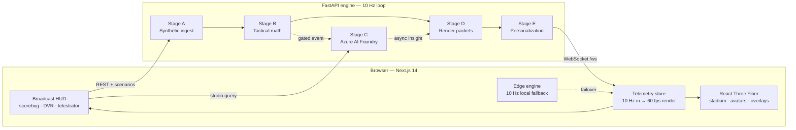

<div align="center">

# AETHER PITCH

**A real-time 3D football broadcast studio driven by 100% synthetic telemetry and a deterministic five-stage Azure AI pipeline.**

[](https://nextjs.org/)
[](https://docs.pmnd.rs/react-three-fiber)
[](https://fastapi.tiangolo.com/)
[](https://www.python.org/)
[](https://azure.microsoft.com/)
[](#synthetic-data)

[Quick Start](#quick-start) · [Features](#features) · [Architecture](#architecture) · [API](#api-reference) · [Configuration](#configuration) · [Testing](#testing--verification)

</div>

---

AETHER PITCH turns a deterministic synthetic football match into a broadcast-grade, interactive 3D experience in the browser. A 10 Hz FastAPI engine drives 22 articulated players, tactical overlays, a 15-second DVR, AI commentary, and per-fan personalization. Every club, player, crest, and tracking sample is synthetic.

The project was built for the **Premier League × Microsoft Azure "Inside the Game" hackathon**. Azure services are optional: without credentials, every stage falls back to a deterministic local implementation, so the full studio runs offline. For the full architecture, mathematical appendix, and demo script, see [SUBMISSION_GUIDE.md](SUBMISSION_GUIDE.md).

## Highlights

- **Live 3D broadcast** — 60 FPS React Three Fiber stadium, articulated player rigs, four camera modes, volumetric overlays, and broadcast alpha output.
- **Five-stage pipeline** — synthetic ingest, deterministic tactical math, asynchronous AI explanation, render packets, and personalization.
- **Explainable analytics** — Pass Difficulty Rating, Expected Threat, Ghost Pass, Chaos Index, pressing metrics, and defensive line analysis.
- **Fan runtime** — persona modes, metric locking, club bias, locked players, and EN/ES/AR/HI commentary without restarting the stream.
- **Resilient by design** — a 10 Hz browser edge engine takes over if the WebSocket or Azure pipeline drops, then hot-swaps back when it returns.

## Contents

- [Features](#features)
- [Architecture](#architecture)
- [Quick Start](#quick-start)
- [Configuration](#configuration)
- [Using the Studio](#using-the-studio)
- [API Reference](#api-reference)
- [Project Structure](#project-structure)
- [Testing & Verification](#testing--verification)
- [Deployment](#deployment)
- [Synthetic Data](#synthetic-data)
- [Contributing](#contributing)
- [License](#license)

## Features

### Broadcast and visualization

- **105 × 68 m stadium** with regulation markings, goalposts and nets, LED advertising boards, floodlights, and an instanced crowd.
- **22 articulated avatars** with procedural gait, sprint lean, kick animation, goalkeeper stance, jersey numbers, and PlayStyle badges.
- **Four camera modes** — Tele Cam, Pro Cam, Drone Orbit, and Auto-Director. AI camera directives can take over temporarily; a manual camera choice cancels the takeover.
- **15-second DVR and 3D telestrator** — freeze and scrub live play, inspect sprint/chaos markers, and draw spotlight pillars, an offside wall, a compactness hull, ghost-ball replays, and tactical arrows.
- **Tactical layers** — xT threat grid, defensive laser links, parabolic pass tubes, Ghost Pass counterfactuals, pitch-control surface, and passing network.
- **Broadcast alpha mode** — open `/?overlay=alpha` for a transparent/chroma-ready AR layer with SMPTE timecode and a machine-readable render-partner packet.
- **Match chrome** — scorebug, momentum and win-probability bars, tactical pulse, lower thirds, GOAL slam, and player lock hologram.

### AI and analytics

- **Stage A — ingest:** deterministic 10 Hz PitchForge simulation with 3D pose state, ball physics, event detection, and milestone tracking.
- **Stage B — interpret:** NumPy tactical math for Chaos Index, PDR, 16 × 12 xT, Ghost Pass, AI gating, leverage, PPDA, and defensive lines.
- **Stage C — explain:** asynchronous causal narratives and studio answers through Azure AI Foundry / Azure OpenAI, with a local fallback.
- **Stage D — render:** time-coded overlay packets, highlight zones, and camera directives for the 3D scene.
- **Stage E — personalize:** analyst/casual/split personas, metric lock, club lens, locked-player context, and localized commentary.
- **Ask The 12th Man:** ask a tactical question and receive a reasoning chain, localized answer, commentator cue, and a scene directive that moves the camera and overlays.
- **Three-act recap:** milestone-driven storyboard with full 22-player snapshots, ghost passes, localized narration, teleprompter export, and 3D time travel.

### Fan experience and reliability

- **Fan Personalization Tuner** with live persona, metric, club, player, and language controls.
- **60-second judge autopilot** that runs a six-step guided tour with synchronized voiceover.
- **Five-stage pipeline inspector** and a one-click rubric audit at `GET /api/health/pipeline-audit`.
- **Resilient match engine** that switches to a browser-native 10 Hz simulation during backend or Azure failures.

## Architecture



The 10 Hz loop never waits on Stage C. Cloud reasoning is dispatched as an async task, so a slow model cannot stall the match. If Azure credentials are absent, Stage C and Stage E use deterministic local fallbacks and Stage D stays on the local WebSocket transport.

### Pipeline contract

| Stage | Responsibility | Key outputs | Blocking |
|---|---|---|---|
| **A — Ingest** | Synthetic physics, player/ball state, event and milestone detection | 22 players, ball, pose state, raw events, milestones | Yes, 10 Hz heartbeat |
| **B — Interpret** | Deterministic NumPy tactical analysis | Chaos, PDR, xT, Ghost Pass, gate, leverage | Yes, sub-millisecond |
| **C — Explain** | Azure AI Foundry agents and local fallback narratives | Commentary, studio answers, recap acts | No, asynchronous |
| **D — Render** | Broadcast overlay and camera packets | Overlays, highlight zones, camera directives | Yes, cheap |
| **E — Personalize** | Persona, metric, club, player, and language adaptation | Localized fan story and HUD payload | Yes, cheap |

### Technology stack

| Layer | Technologies |
|---|---|
| **Frontend** | Next.js 14 (App Router), React 18, TypeScript, React Three Fiber, Three.js, Drei, postprocessing, Tailwind CSS |
| **Backend** | Python, FastAPI, Uvicorn, NumPy, Pydantic, python-dotenv |
| **AI and cloud (optional)** | Azure AI Foundry / Azure OpenAI, Azure AI Translator, Azure Web PubSub configuration, Azure Container Apps |
| **Delivery** | Docker, Docker Compose, Azure Developer CLI (`azd`), start scripts for Windows and macOS/Linux |

## Quick Start

### Prerequisites

| Requirement | Version |
|---|---|
| Python | 3.11+ recommended |
| Node.js | 20+ |
| npm | 10+ |
| Docker | Optional, for the container stack |

### One-command launch

**Windows**

```bat
start_studio.bat
```

**macOS / Linux**

```bash
bash start_studio.sh
```

The launcher installs dependencies, starts both services, and opens the studio.

| Service | URL |
|---|---|
| Studio UI | http://localhost:3000 |
| Backend | http://localhost:8000 |
| OpenAPI docs | http://localhost:8000/docs |

### Manual launch

Terminal 1 — backend:

```bash
cd backend
python -m venv .venv

# Windows
.venv\Scripts\activate

# macOS / Linux
source .venv/bin/activate

python -m pip install -r requirements.txt
python -m uvicorn main:app --reload --port 8000
```

Terminal 2 — frontend:

```bash
cd frontend
npm install
npm run dev
```

Open http://localhost:3000.

### Docker Compose

```bash
docker compose up --build
```

The backend health check uses `GET /api/health`; the frontend waits for the backend to become healthy before starting.

## Configuration

Copy the example environment file before adding Azure credentials:

```bash
cp backend/.env.example backend/.env
```

On Windows PowerShell:

```powershell
Copy-Item backend/.env.example backend/.env
```

All Azure settings are optional. Without them, the studio runs on deterministic local fallbacks.

| Variable | Default | Purpose |
|---|---|---|
| `AZURE_OPENAI_ENDPOINT` | empty | Azure OpenAI / AI Foundry endpoint for Stage C |
| `AZURE_OPENAI_API_KEY` | empty | Stage C API key |
| `AZURE_OPENAI_API_VERSION` | `2024-06-01` | Azure OpenAI API version |
| `AZURE_OPENAI_TRIAGE_DEPLOYMENT` | `gpt-4o-mini` | Fast triage model deployment |
| `AZURE_OPENAI_NARRATIVE_DEPLOYMENT` | `gpt-4o` | Narrative and recap model deployment |
| `AZURE_TRANSLATOR_KEY` | empty | Azure AI Translator key for Stage E |
| `AZURE_TRANSLATOR_ENDPOINT` | `https://api.cognitive.microsofttranslator.com` | Translator endpoint |
| `AZURE_TRANSLATOR_REGION` | `global` | Translator region |
| `AZURE_WEBPUBSUB_CONNECTION_STRING` | empty | Optional Web PubSub configuration; local WebSocket is the default |
| `AZURE_WEBPUBSUB_HUB` | `aether` | Web PubSub hub name |
| `MATCH_START_MINUTE` | `62.0` | Match clock at engine startup |
| `AETHER_SEED` | `42` | Deterministic simulation seed |
| `AETHER_HOST` | `0.0.0.0` | Backend bind address |
| `AETHER_PORT` | `8000` | Backend bind port |

Frontend environment variables (set in `frontend/.env.local` or the container environment):

| Variable | Default | Purpose |
|---|---|---|
| `NEXT_PUBLIC_API_URL` | `http://localhost:8000` | REST base URL |
| `NEXT_PUBLIC_WS_URL` | `ws://localhost:8000/ws` | WebSocket URL |

## Using the Studio

1. Open http://localhost:3000 and let the match clock begin at minute 62.
2. Click **Run 60s Judge Autopilot** for a guided tour of the CV viewport, camera direction, DVR/telestrator, alpha mode, personalization, and the three-act recap.
3. Use the Camera Director to switch modes and toggle xT, Ghost Pass, defensive lasers, pitch control, and the passing network.
4. Freeze the DVR to scrub the last 15 seconds; selecting a historical frame pauses live recording until playback resumes.
5. Open http://localhost:3000/?overlay=alpha for the transparent broadcast layer.

### Scenario shortcuts

| Key | Scenario | Effect |
|---|---|---|
| `1` | `chaos_counter` | Injects a chaotic counter-attack window |
| `2` | `high_press_turnover` | Forces a high-press turnover and pressure trap |
| `3` | `tactical_inversion` | Inverts the tactical shape and triggers AI analysis |
| `4` | `halftime_recap` | Opens the three-act Studio Match Recap |

Keyboard shortcuts are ignored while typing in inputs, textareas, selects, or editable fields, and while a modal is open.

### Camera modes

| Mode | Behavior |
|---|---|
| **Tele Cam** | Classic broadcast angle |
| **Pro Cam** | Third-person chase behind the locked avatar |
| **Drone Orbit** | Free orbit around the 3D twin |
| **Auto-Director** | Switches to a dramatic low angle during high-chaos moments or directed overlays |

## API Reference

Base URL: `http://localhost:8000` · WebSocket: `ws://localhost:8000/ws`

### REST endpoints

| Method | Endpoint | Description |
|---|---|---|
| `GET` | `/api/health` | Service health, active stage backends, connected clients, clock, and score |
| `GET` | `/api/health/pipeline-audit` | Synchronous five-stage self-test with per-stage timings and sample payloads |
| `GET` | `/api/state` | Latest match state, metrics, and pipeline trace |
| `GET` | `/api/insights` | Recent Stage C insight packets |
| `GET` | `/api/personalization` | Current personalization state |
| `POST` | `/api/personalization` | Update persona, metric, club, player, or language preferences |
| `GET` | `/api/match-recap` | Build and return the current three-act recap |
| `POST` | `/api/match-recap` | Trigger the same recap build |
| `GET` / `POST` | `/api/scenario/{name}` | Inject `chaos_counter`, `high_press_turnover`, `tactical_inversion`, or `halftime_recap` |
| `POST` | `/api/studio-query` | Ask the tactical co-pilot a question |

### Studio query example

```bash
curl -X POST http://localhost:8000/api/studio-query \
  -H "Content-Type: application/json" \
  -d '{"query":"Why did the high press leave a gap?","language":"en","persona":"analyst","locked_player_id":"NLA_7"}'
```

`query` is required and must be a non-empty string. `language`, `persona`, and `locked_player_id` are optional; malformed JSON objects or non-string queries return `400`.

### Personalization example

```bash
curl -X POST http://localhost:8000/api/personalization \
  -H "Content-Type: application/json" \
  -d '{"persona_mode":"ANALYST_HUD","metric_focus":"PASS_QUALITY","favorite_club_bias":"NLA_LOYALIST","market_language":"es","locked_player_id":"NLA_7"}'
```

Accepted values:

- `persona_mode` — `ANALYST_HUD`, `CASUAL_STORY`, `TWINCAST_SPLIT`
- `metric_focus` — `ALL`, `SPEED_VELOCITY`, `PASS_QUALITY`, `EXPECTED_THREAT_XT`, `CHAOS_PRESSING`
- `favorite_club_bias` — `NEUTRAL`, `NLA_LOYALIST`, `MCS_LOYALIST`
- `market_language` — `en`, `es`, `ar`, `hi`
- `locked_player_id` — any player ID, for example `NLA_7`

### Scenario example

```bash
curl -X POST http://localhost:8000/api/scenario/chaos_counter
```

### WebSocket packets

The server broadcasts JSON packets over `/ws`:

| Type | Rate | Content |
|---|---|---|
| `hello` | On connect | Initial state snapshot and connection metadata |
| `tick` | 10 Hz | Full match state (players, ball, clock, score) |
| `metrics` | 2 Hz | Tactical metrics and derived indicators |
| `pipeline` | 2 Hz | Per-stage latency and payload trace |
| `event` | On event | Match, tactical, and milestone events |
| `insight` | Async | Stage C/D/E broadcast packet |
| `recap` | On request | Three-act recap packet |

The frontend interpolates the 10 Hz stream to 60 FPS through a mutable telemetry store, keeping React out of the per-tick render path.

## Project Structure

```text
.
├── backend/
│   ├── main.py                        # FastAPI app, match loop, REST + WebSocket hub
│   ├── config.py                      # Environment-backed settings
│   ├── stage_a_synthetic_engine.py    # 10 Hz synthetic match, events, milestones
│   ├── stage_b_math_engine.py         # Chaos, PDR, xT, Ghost Pass, gating
│   ├── stage_c_foundry_agents.py      # Azure AI Foundry narratives and studio queries
│   ├── stage_d_e_personalizer.py      # Render packets and fan personalization
│   ├── test_pipeline.py               # Offline five-stage pipeline self-test
│   ├── requirements.txt
│   ├── .env.example
│   └── Dockerfile
├── frontend/
│   ├── src/app/                       # Next.js App Router page and layout
│   ├── src/components/                # HUD, DVR, tuner, recap, autopilot, modals
│   ├── src/components/three/          # Stadium, avatars, overlays, camera rig
│   ├── src/hooks/                     # Resilient match engine, speech, studio state
│   ├── src/lib/                       # Schema types, telemetry store, edge engine
│   ├── package.json
│   └── Dockerfile
├── docker-compose.yml
├── azure.yaml
├── start_studio.bat
├── start_studio.sh
├── SUBMISSION_GUIDE.md
└── README.md
```

## Testing & Verification

Run the backend pipeline self-test:

```bash
python backend/test_pipeline.py
```

Expected result: `RESULT: ALL PIPELINE TESTS PASSED`.

Build the frontend for a production check:

```bash
cd frontend
npm run build
```

Optional backend static check:

```bash
python -m pip install pyflakes
python -m pyflakes backend
```

The backend self-test exercises all five stages without requiring Azure credentials or network access.

## Deployment

### Docker Compose

```bash
docker compose up --build
```

This starts the FastAPI engine on port 8000 and the Next.js studio on port 3000.

### Azure Container Apps

`azure.yaml` provides an Azure Developer CLI manifest for the two services. Configure your own `azd` environment and infrastructure, then run:

```bash
azd up
```

Set `NEXT_PUBLIC_API_URL` and `NEXT_PUBLIC_WS_URL` to the public backend endpoints in the deployed frontend environment.

## Synthetic Data

- All clubs, players, crests, names, and tracking data are fictional and generated locally.
- No Opta, StatsBomb, Second Spectrum, broadcast footage, or other proprietary source is used.
- The simulation is seeded (`AETHER_SEED`) for reproducible runs.
- This is a hackathon demonstration, not a production match-data or betting system.

## Contributing

Issues and pull requests are welcome. Before opening a pull request:

1. Run `python backend/test_pipeline.py`.
2. Run `npm run build` in `frontend/`.
3. Keep new telemetry fields typed in `frontend/src/lib/types.ts` and mirrored in the backend packet schemas.

## License

No license file is currently included in this repository. All rights remain with the repository owner. Third-party product names and trademarks belong to their respective owners.
