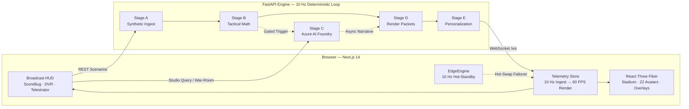

<div align="center">

# AETHER PITCH

### Real-Time 3D Digital Twin & Multi-Agent Tactical Studio for Football

A real-time 3D football broadcast platform driven by 100% synthetic telemetry, deterministic spatial mathematics, and an adversarial multi-agent reasoning layer with zero-hallucination guardrails.

[](https://nextjs.org/)
[](https://docs.pmnd.rs/react-three-fiber)
[](https://fastapi.tiangolo.com/)
[](https://www.python.org/)
[](https://azure.microsoft.com/)
[](#synthetic-data--ip-provenance)

**Repository:** `github.com/shashankh3/aether-pitch` · **Branch:** `main`  
**Scale:** 143 tracked files · ~30,999 LOC of Python + TypeScript (112 source files) · **359 automated assertions** (237 backend · 89 headless logic · 33 headless UI render) · 16-resource Azure ARM template

[Overview](#overview) · [Key Capabilities](#key-capabilities) · [System Architecture](#system-architecture) · [Quick Start](#quick-start) · [Studio Interactions](#studio-interactions) · [API Reference](#api-reference) · [Testing & Verification](#testing--verification)

</div>

---

## Overview

Live sports broadcasts force a false dichotomy: raw telemetry dashboards that overwhelm viewers, or generative commentary that hallucinates match statistics. **AETHER PITCH** eliminates both with a deterministic, multi-stage architecture.

Running on 100% self-generated, IP-clean synthetic telemetry — **North Larchmont Athletic (NLA)** vs. **Meridian City SC (MCS)** in the *AETHER Synthetic League* — the platform operates a five-stage pipeline at **10 Hz**, interpolated to **60 FPS** in WebGL:

1. **Stage A (Synthetic Ingest):** Frame-reproducible 22-player kinematics, ball physics, machine auto-eventing, and a metabolic bio-load digital twin (`seed=42`).
2. **Stage B (Spatial Math):** Pure NumPy spatial analytics — Expected Threat (xT), Pass Difficulty Rating (PDR), Pitch Control, Chaos Index, PPDA, and counterfactual Ghost Passes.
3. **Stage C (Reasoning & Explain):** Azure AI Foundry (`gpt-4o` + `gpt-4o-mini`) multi-agent orchestration governed by a deterministic **Numeric Critic** that audits narrative claims against live Stage B state.
4. **Stage D (Volumetric Render):** Synchronized React Three Fiber telestration, autonomous camera work, and SMPTE alpha broadcast overlays.
5. **Stage E (Personalize & Localize):** Dynamic cognitive density, persona adaptation, accessibility palettes, and real-time multi-language localization (EN / ES / AR / HI) via Azure AI Translator.

> **Zero-Downtime Guarantee:** Every metric displayed on screen is computed by deterministic football mathematics. If cloud connectivity drops mid-match, an active browser-native EdgeEngine maintains continuous 10 Hz simulation and 60 FPS rendering with zero dropped frames.

For competition judges and evaluators, see [`SUBMISSION_GUIDE.md`](SUBMISSION_GUIDE.md) for full prize-track mappings, official rules checklists, and evaluation runbooks.

| Document | Focus & Coverage |
|---|---|
| [`SUBMISSION_GUIDE.md`](SUBMISSION_GUIDE.md) | Competition rubric mapping, two-minute evaluation path, mathematical appendix, portal documentation |
| [`docs/ARCHITECTURE.md`](docs/ARCHITECTURE.md) | Complete module map, 5-stage pipeline contracts, 4 resilience layers, counterfactual state machines |
| [`docs/RUNTIME_CONFIG.md`](docs/RUNTIME_CONFIG.md) | Per-request server-side backend coordinate hydration pattern (no `NEXT_PUBLIC_*` bundling risks) |
| [`CONTRIBUTING.md`](CONTRIBUTING.md) | Code quality gate, test requirements, branch policies, and ground rules |

---

## Key Capabilities

### 1. Cinematic 3D Digital Twin & Broadcast Studio
- **Procedural Night Stadium:** Regulation turf markings, goalposts and nets, dynamic floodlight beams, LED advertising boards, 1,600 instanced crowd members, camera flashes, twin jumbotrons, and procedural ball trails.
- **22 Articulated Kinematic Avatars:** Procedural gait, sprint lean, kick and tackle kinematics, goalkeeper stances, jersey numbers, and dynamic player-lock holograms.
- **Dynamic Camera Choreography:** Four distinct camera modes (Tele Cam, Pro Cam, Drone Orbit, Auto-Director) with smooth transitions, dynamic FOV adjustment, and goal-impact camera shake.
- **15-Second DVR & Volumetric 3D Telestrator:** Scrub, pause, and inspect live play with volumetric spotlights, offside line walls, team compactness convex hulls, and tactical arrows.
- **SMPTE Broadcast Alpha Output:** Open `/?overlay=alpha` for a chroma-ready transparent AR graphics layer with SMPTE timecode and machine-readable render metadata.
- **Clean-Feed Presentation:** Press `H` to hide HUD chrome for a clean cinematic feed, or `F` to toggle fullscreen.

### 2. Deterministic Spatial Football Analytics (Stage B)
- **Expected Threat (xT):** Real-time 16×12 spatial threat grid evaluating continuous territorial danger from passing and ball carrying.
- **Pass Difficulty Rating (PDR):** Dynamic pass difficulty calculated using receiver intercept radius, defensive lane density, and passing vector velocity.
- **Pitch Control & Territorial Attribution:** Real-time Voronoi and velocity-weighted spatial ownership attributing each cell on the pitch to NLA, MCS, or neutral contention.
- **Tactical Dynamics:** Continuous measurement of Chaos Index (match turnover tempo), PPDA (passes allowed per defensive action), pressing triggers, and defensive line height.
- **Counterfactual Ghost Pass Simulation:** Live calculation of alternative passing options with projected net xT gain (`net_xt_gain`), completion probability, and 3D counterfactual trajectory rendering.

### 3. Adversarial Multi-Agent Bench War-Room (Stage C)
- **Sequential 3-Agent Tactical Debate (`POST /api/tactical-war-room`):**
  - **Turn 1 — Manager (`NLATacticalManagerAgent`):** Proposes proactive tactical adjustments using live Stage B spatial tools (`gpt-4o`).
  - **Turn 2 — Scout (`MCSOppositionScoutAgent`):** Reads the manager's proposal and counters with tactical defensive responses (`gpt-4o-mini`).
  - **Turn 3 — Arbiter (`SpatialArbiterAgent`):** Reviews both turns against live Expected Threat tensors and delivers a definitive **Tactical Prescription** (`gpt-4o`).
- **Inspectable Provenance:** Every call reports its exact deployment, execution latency, token consumption, and tool invocation count.
- **3D Pitch Projection:** Recommended adjustments project directly onto the 3D turf with glowing tactical displacement vectors and highlighted overload zones.
- **Zero-Config Fallback:** A browser-native twin (`warRoom.ts`) reproduces the identical 3-agent debate offline if cloud services are unreachable.

### 4. Enterprise Responsible AI & Numeric Critic
- **Pre-Flight Prompt Shield (`backend/rai_shield.py`):** Screens every studio query before calling cloud models. Blocks prompt injections, role hijacks, jailbreaks, and out-of-scope queries with 0 model token burn, returning grounded local deflections.
- **Post-Flight Numeric Critic (`backend/agent_trace.py`):** Automatically parses numeric claims from generative responses and cross-checks them against live Stage B ground truth. Any discrepancy triggers immediate rollback to a deterministic template.
- **Secondary Cloud Guardrail (`backend/content_safety.py`):** Optional Azure AI Content Safety evaluation running alongside deterministic checks for defense-in-depth.
- **Live RAI Scorecard:** Control Center displays live telemetry for Mathematical Groundedness, Tactical Coherence, and P95 latency against the 100 ms broadcast budget.

### 5. Predictive Bio-Load Digital Twin
- **Rolling Metabolic Accumulator:** High-intensity load monitoring per player publishing `bio_load_profile` at 10 Hz.
- **Fatigue Forecasting:** 10-minute stamina burn projections, fatigue-adjusted PDR penalties, and role-specific tactical substitution/relief directives.
- **PlayerLock 360:** Volumetric HUD displaying real-time fatigue gauges, stamina burn forecasts, and tactical guidance.

### 6. Zero-Downtime Cloud-to-Edge Resilience
- **Active Hot-Standby Twin (`frontend/src/lib/edgeEngine.ts`):** 1,782 LOC TypeScript twin running directly inside the browser.
- **Seamless Failover:** If WebSocket connectivity or cloud services disconnect, the EdgeEngine immediately takes over 10 Hz simulation with 0 dropped render frames.
- **State Reconciliation:** Automatically reconciles match clock and event states upon reconnection.

### 7. Fan Personalization & Accessibility (Stage E)
- **Adaptive Cognitive Telemetry Density:**
  - `CASUAL_STORYTELLER` — Narrative-first, jargon-free match storytelling.
  - `FANTASY_HUNTER` — Speed milestones, stamina burn rates, and individual ΔxT metrics.
  - `PRO_TACTICAL_DIRECTOR` — Comprehensive spatial metrics (xT, PDR, PPDA, Voronoi lines, pressing zones).
- **Plain-Language Fan Mode:** One-tap toggle translating technical metrics into standard football phrasing (*xT* → **Pass quality**, *PPDA* → **Pressing**, *Bio-Load* → **Fatigue**).
- **Inclusive Accessibility:** Built-in deuteranopia/protanopia colorblind-safe palettes (electric cyan `#00E5FF` vs warm amber `#FFB300`), reduced motion support, ARIA live announcements, and full keyboard navigation.
- **Real-Time Localization:** Live multi-language commentary and UI translation across English, Spanish, Arabic, and Hindi via Azure AI Translator.

---

## System Architecture

```text
BROWSER CLIENT (Next.js 14 / React 18 / React Three Fiber)
 ├─ 3D Volumetric Stage: Procedural Stadium · 22 Articulated Avatars (14-part rigs) · Broadcast Camera Rig
 ├─ Broadcast HUD: TopBar · ScoreBug · LeftRail · BottomDock (DVR) · RightDock (8-Tab Control Center)
 ├─ Telemetry Store: 10 Hz WebSocket Ingest ──► 60 FPS interpolation (linear + velocity extrapolation)
  └─ EdgeEngine (1,782 LOC browser-native twin) ◄── active hot-standby, 0 ms reload on cloud drop
        │
        │ WebSocket (/ws @ 10 Hz) + REST control plane
        ▼
FASTAPI BACKEND ENGINE (10 Hz deterministic loop)
  ├─ Stage A  Synthetic ingest (1,075 LOC) ──► kinematics, ball physics, auto-eventing, bio-load twin
  ├─ Stage B  Deterministic math (858 LOC) ──► xT grid, PDR, PPDA, Chaos, pitch control, ghost pass
  ├─ Stage C  Foundry agent router (1,832 LOC) ──► 4-node insight pipeline + 3-turn war-room
  ├─ RAI & numeric critic (748 LOC) ──► prompt shield + grounding verifier + club-neutrality gate
  └─ Stage D & E  Personalizer (555 LOC) ──► camera directives, overlays, persona & i18n
        │
        ├──► Azure AI Foundry (Azure OpenAI: gpt-4o narrative / gpt-4o-mini triage)
        ├──► Azure AI Translator (real-time EN / ES / AR / HI broadcast localization)
        └──► Azure AI Content Safety (optional cloud secondary RAI inspection layer)
```

### Data Flow



### 5-Stage Pipeline Contract

| Stage | Name | Key Outputs | SLA / Execution |
|---|---|---|---|
| **A** | **Synthetic Ingest** | 22-player kinematics, ball physics, auto-eventing, bio-load profiles | 10 Hz continuous heartbeat |
| **B** | **Deterministic Math** | Expected Threat (xT), PDR, PPDA, Chaos Index, pitch control, ghost pass | Sub-millisecond (NumPy) |
| **C** | **Foundry Agents** | Multi-agent war-room, narrative insight, numeric critic verification | Asynchronous (non-blocking) |
| **D** | **Render Packets** | Time-coded 3D scene overlays, highlight zones, camera directives | 10 Hz synchronous |
| **E** | **Personalization** | Persona styling, plain-language translation, EN/ES/AR/HI localization | Sub-millisecond |

---

## Quick Start

### Prerequisites

| Component | Minimum Version | Note |
|---|---|---|
| **Python** | 3.11+ | Backend engine |
| **Node.js** | 20+ | Frontend studio |
| **npm** | 10+ | Package manager |
| **Docker** | 24+ | Optional, for containerized run |

### 1. One-Command Launch

**Windows:**
```powershell
start_studio.bat
```

**macOS / Linux:**
```bash
bash start_studio.sh
```

The startup script installs all dependencies, starts backend and frontend services, and opens the studio in your browser.

| Endpoint | URL |
|---|---|
| **Studio UI** | `http://localhost:3000` |
| **Backend REST API** | `http://localhost:8000` |
| **Interactive API Docs** | `http://localhost:8000/docs` |
| **SMPTE Alpha Feed** | `http://localhost:3000/?overlay=alpha` |

### 2. Manual Setup

**Terminal 1 — Backend:**
```bash
cd backend
python -m venv .venv

# Windows
.venv\Scripts\activate
# macOS / Linux
source .venv/bin/activate

python -m pip install -r requirements.txt
python -m uvicorn main:app --reload --port 8000
```

**Terminal 2 — Frontend:**
```bash
cd frontend
npm install
npm run dev
```

Open `http://localhost:3000` in your browser.

### 3. Docker Compose

```bash
docker compose up --build
```

The container stack launches the FastAPI backend and Next.js frontend with integrated health checks (`GET /api/health`).

---

## Studio Interactions

### Keyboard Shortcuts

| Key | Action |
|---|---|
| `1` | Inject `chaos_counter` match scenario |
| `2` | Inject `high_press_turnover` match scenario |
| `3` | Inject `tactical_inversion` match scenario |
| `4` | Open 3-Act Match Recap Studio |
| `L` | Open Control Center → Watch Tab |
| `A` | Open Control Center → Stats Tab |
| `S` | Open Control Center → Studio Tab |
| `H` | Toggle clean broadcast feed (hide HUD) |
| `F` | Toggle fullscreen mode |
| `?` | Show keyboard shortcuts modal |
| `Esc` | Close Control Center, popovers, or active modal |

### Camera Modes

| Mode | Angle & Behavior |
|---|---|
| **Tele Cam** | Classic broadcast elevated sideline camera |
| **Pro Cam** | Dynamic third-person tracking behind the locked avatar |
| **Drone Orbit** | Free interactive 360° orbit around the pitch |
| **Auto-Director** | Dynamic cinematic framing switching on high-chaos events and goals |

---

## Interactive Spatial "What-If" Sandbox

The 3D stage functions as an interactive tactical laboratory rather than a passive broadcast feed:

1. Open the bottom dock **Replay** popover and arm the **What-If Sandbox**.
2. Click and drag any avatar across the pitch.
3. The browser-native Stage B twin recalculates the 16×12 Expected Threat grid and pitch ownership live under your cursor at 60 FPS without React re-renders.
4. **Collective Defensive Line Scrubber:** Slide an entire 4-man backline unit between 18 m and 52 m from their goal; the block shifts dynamically while recomputing through-ball exposure, offside trap catch probability, and compactness area.
5. **Adjudication:**
   - **Send to War-Room:** Dispatches coordinates to `POST /api/tactical-war-room`.
   - **Submit to Arbiter:** Posts to `POST /api/counterfactual-query` for a numeric-critic-verified tactical ruling.

```text
POST /api/counterfactual-query
Request:  { match_id, minute, displacements: [{ player_id, original_coords, displaced_coords }] }
Response: { projected_xt_shift, pitch_control_shift_pct, structural_vulnerability_index, arbiter_verdict, numeric_grounding_verified }
```

---

## API Reference

**Base URL:** `http://localhost:8000` · **WebSocket:** `ws://localhost:8000/ws`

### REST Endpoints

| Method | Endpoint | Description |
|---|---|---|
| `GET` | `/api/health` | Service health, active stage status, client count, match clock, and score |
| `GET` | `/api/health/pipeline-audit` | Synchronous 5-stage self-test with per-stage latencies, P95 timing, and RAI scorecard |
| `GET` | `/api/state` | Current match state, 22-player coordinates, and tactical telemetry |
| `GET` | `/api/match-stats` | Match stats, pass accuracy, possession percentages, and distance leaders |
| `GET` | `/api/insights` | Recent Stage C narrative insight packets and agent handoff traces |
| `GET` | `/api/personalization` | Active fan personalization preferences |
| `POST` | `/api/personalization` | Update persona density, metric focus, club bias, locked player, or language |
| `GET` | `/api/match-recap` | Fetch current 3-act milestone-driven match recap |
| `POST` | `/api/match-recap` | Trigger on-demand generation of match recap |
| `GET` | `/api/scenario/{name}` | Fetch details for scenario (`chaos_counter`, `high_press_turnover`, `tactical_inversion`, `halftime_recap`) |
| `POST` | `/api/scenario/{name}` | Inject specific tactical match scenario |
| `POST` | `/api/studio-query` | Query tactical co-pilot with pre-flight Prompt Shield screening |
| `POST` | `/api/tactical-war-room` | Execute 3-agent adversarial bench debate (Manager → Scout → Arbiter) |
| `POST` | `/api/counterfactual-query` | Adjudicate What-If player displacement with numeric critic cross-check |

### WebSocket Protocol (`/ws`)

The server streams structured JSON packets over WebSocket at 10 Hz:

| Packet | Rate | Payload Description |
|---|---|---|
| `hello` | On connect | Match initialization metadata and telemetry schema version |
| `tick` | 10 Hz | 22-player 3D positions, ball physics, match clock, score, bio-load profiles |
| `metrics` | 2 Hz | Aggregated match metrics (xT, PDR, PPDA, Chaos Index, pitch control splits) |
| `pipeline` | 2 Hz | Live 5-stage pipeline latencies, token usage, and execution telemetry |
| `event` | On event | Auto-evented tackles, shots, turnovers, and milestone triggers |
| `insight` | Asynchronous | Stage C narrative commentary with agent handoff trace and grounding metadata |
| `recap` | On demand | 3-act structured match recap packet |

---

## Configuration

Copy the example environment configuration before configuring Azure services:

```bash
# macOS / Linux
cp backend/.env.example backend/.env

# Windows PowerShell
Copy-Item backend/.env.example backend/.env
```

All cloud settings are optional. Without Azure credentials, the studio operates entirely offline using deterministic local fallbacks.

### Backend Environment Variables (`backend/.env`)

| Variable | Default | Purpose |
|---|---|---|
| `AZURE_OPENAI_ENDPOINT` | empty | Azure AI Foundry / OpenAI endpoint for Stage C |
| `AZURE_OPENAI_API_KEY` | empty | Azure OpenAI API key |
| `AZURE_OPENAI_API_VERSION` | `2024-06-01` | Azure OpenAI API version |
| `AZURE_OPENAI_TRIAGE_DEPLOYMENT` | `gpt-4o-mini` | Fast triage model deployment |
| `AZURE_OPENAI_NARRATIVE_DEPLOYMENT` | `gpt-4o` | Deep reasoning and narrative model deployment |
| `AZURE_TRANSLATOR_KEY` | empty | Azure AI Translator API key for Stage E |
| `AZURE_TRANSLATOR_ENDPOINT` | `https://api.cognitive.microsofttranslator.com` | Azure Translator endpoint |
| `AZURE_TRANSLATOR_REGION` | `global` | Azure Translator region |
| `MATCH_START_MINUTE` | `62.0` | Initial match clock minute |
| `AETHER_SEED` | `42` | Deterministic simulation seed |
| `AETHER_HOST` | `0.0.0.0` | Backend bind host |
| `AETHER_PORT` | `8000` | Backend bind port |

### Frontend Environment Variables (`frontend/.env.local`)

| Variable | Default | Purpose |
|---|---|---|
| `AETHER_API_URL` | `http://localhost:8000` | Backend REST base URL (hydrated server-side per request) |
| `AETHER_WS_URL` | `ws://localhost:8000/ws` | Backend WebSocket URL (resolved in browser) |
| `BACKEND_ORIGIN` | `http://localhost:8000` | Origin used by Next.js `/api` proxy routes |

> **Server-Side Runtime Hydration:** Rather than baking static `NEXT_PUBLIC_*` variables into client JavaScript bundles at build time, backend coordinates are resolved dynamically on the server per request and injected into the document shell. For details, see [`docs/RUNTIME_CONFIG.md`](docs/RUNTIME_CONFIG.md).

---

## Testing & Verification

The repository enforces strict verification across all pipeline stages:

### 1. Backend Pipeline Self-Test
```bash
python backend/test_pipeline.py
```
Expected output: `RESULT: ALL 237 PIPELINE TESTS PASSED`. Validates all five pipeline stages, executes the compliance scan (`(97 files scanned)`), and validates ARM templates.

### 2. Async Resilience & Fault-Tolerance Suite
```bash
python backend/test_resilience.py
```
Expected output: `ALL 9 RESILIENCE & ASYNC TRANSPORT TESTS PASSED`. Validates async retries, timeouts, and circuit breaker operation.

### 3. Frontend Logic & UI Smoke Tests
```bash
cd frontend
npm run check:logic     # Headless spatial and state logic assertions
npm run smoke:ui        # Headless component render assertions
npm run build           # Production Next.js build
npm run smoke           # Production SSR hydration smoke test
```
Or execute the entire sequence via:
```bash
npm run verify
```

### 4. Documentation & Specification Lint
```bash
python tools/doc_lint.py
```
Ensures that every documented statistic, route, script, and code size matches the live repository with zero doc drift.

### 5. Azure Infrastructure Template Validation
```bash
python infra/validate_template.py
```
Statically validates [`infra/main.json`](infra/main.json) without requiring an active Azure subscription.

---

## Project Structure

```text
.
├── backend/
│   ├── main.py                        # FastAPI application, match loop, REST & WebSocket hub
│   ├── runtime.py                     # WebSocket fan-out hub & connection state manager
│   ├── config.py                      # Environment-backed application settings
│   ├── stage_a_synthetic_engine.py    # 10 Hz kinematic simulation, physics & eventing
│   ├── stage_b_math_engine.py         # Expected Threat (xT), PDR, PPDA, Chaos Index math
│   ├── stage_c_foundry_agents.py      # Multi-agent orchestrator & router
│   ├── agents/                        # Specialized Foundry agents (Manager, Scout, Arbiter)
│   ├── stage_d_e_personalizer.py      # 3D overlay packets & fan personalization
│   ├── agent_trace.py                 # Grounded handoff trace & numeric critic validation
│   ├── rai_shield.py                  # Pre-flight Prompt Shield & safety defense
│   ├── content_safety.py              # Optional Azure AI Content Safety integration
│   ├── circuit_breaker.py             # Circuit breaker & retry policy for external APIs
│   ├── test_pipeline.py               # Five-stage pipeline & compliance test suite
│   ├── test_resilience.py             # Resilience & transport test suite
│   ├── requirements.txt
│   └── Dockerfile
├── frontend/
│   ├── src/app/                       # Next.js 14 App Router layout & pages
│   ├── src/components/                # Broadcast HUD, Control Center, DVR & Modals
│   ├── src/components/three/          # Stadium, 22 avatars, 3D telestrator & camera rig
│   ├── src/hooks/                     # Resilient match engine & audio speech hooks
│   ├── src/lib/                       # Telemetry store, TypeScript schemas & EdgeEngine
│   ├── package.json
│   └── Dockerfile
├── infra/
│   ├── main.json                      # 16-resource Azure ARM template
│   ├── validate_template.py           # Offline ARM template validator
│   └── README.md                      # Cloud-native deployment guide
├── docs/
│   ├── ARCHITECTURE.md                # In-depth system architecture & module map
│   └── RUNTIME_CONFIG.md              # Server-side runtime configuration specification
├── tools/
│   ├── doc_lint.py                    # Documentation accuracy & assertion linter
│   └── sync_docs.py                   # Automated doc metrics synchronizer
├── docker-compose.yml
├── azure.yaml
├── start_studio.bat
├── start_studio.sh
├── CONTRIBUTING.md
├── SUBMISSION_GUIDE.md
└── README.md
```

---

## Deployment

### Cloud-Native Azure Topology

The project includes an Azure ARM template ([`infra/main.json`](infra/main.json)) provisioning:
- **Azure AI Foundry:** Triage and narrative model deployments.
- **Azure AI Translator:** Real-time multi-language broadcast localization.
- **Azure Container Apps:** Managed containers for frontend and backend services.
- **Azure Key Vault:** Secret storage with Managed Identity authentication.
- **Azure Monitor & Application Insights:** P95 latency tracking and health alerting.

Deploy with the Azure CLI:

```bash
az deployment group create \
  --resource-group rg-aether-pitch \
  --template-file infra/main.json \
  --parameters prefix=aether openAiApiKey=<foundry-key> translatorKey=<translator-key>
```

Refer to [`infra/README.md`](infra/README.md) for detailed cloud configuration instructions.

---

## Synthetic Data & IP Provenance

- **100% Synthetic Telemetry:** All clubs, player rosters, tracking coordinates, physical metrics, and match events are procedurally generated by the Stage A engine.
- **Clean IP:** Features fictional teams (**North Larchmont Athletic** vs. **Meridian City SC**) in the *AETHER Synthetic League*. No real-world player likenesses, club crests, or proprietary match feeds are used.
- **Deterministic Replay:** Setting `AETHER_SEED=42` guarantees frame-for-frame identical match replication across platforms.

---

## Contributing

Contributions and pull requests are welcome. Before submitting code changes:

1. Execute `python backend/test_pipeline.py`.
2. Run `python tools/doc_lint.py` to ensure documentation integrity.
3. Verify the frontend with `npm run build` inside `frontend/`.
4. Ensure new telemetry fields are strictly typed in `frontend/src/lib/types/` and mirrored in backend Pydantic models.

Review [`CONTRIBUTING.md`](CONTRIBUTING.md) for code styling standards and pull request workflows.

---

## License

All rights reserved by the repository owners. Third-party trademarks referenced belong to their respective owners.
